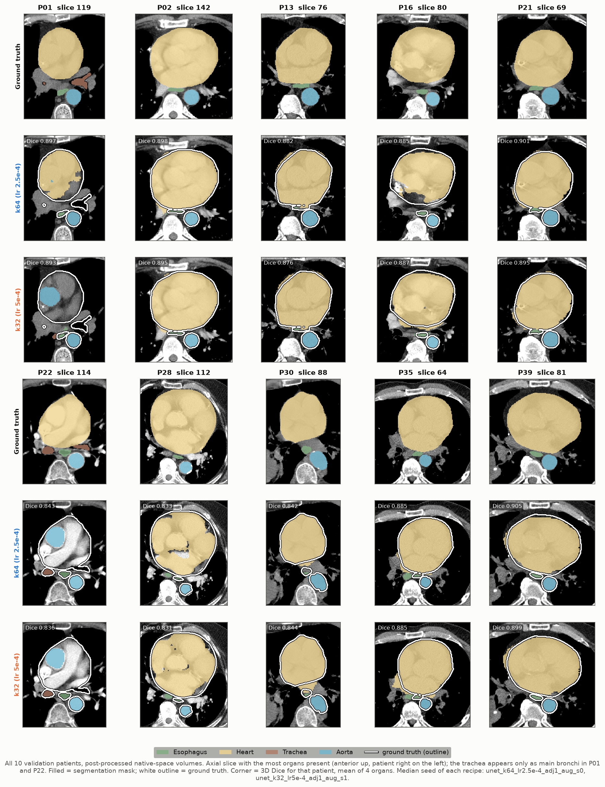
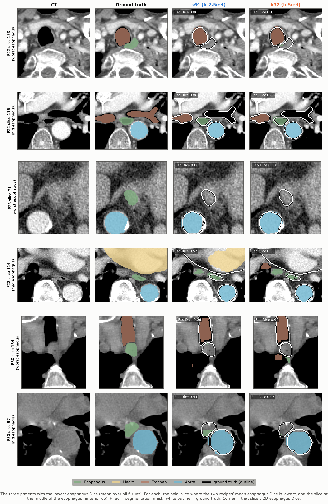

# best_config_eval — Results Report

## Takeaway:

The **k64** recipe has a slightly higher mean Dice3D than k32 (0.877 vs 0.872). It is also **more stable** across seeds. The two recipes are tied on surface-distance metrics. Esophagus is still the weakest organ by a wide margin (≈0.76–0.77 Dice).

## Setup

Six runs: two 2.5D UNet recipes with three seeds each (0, 1, 2). All were trained on the 30/10 SegTHOR split and evaluated on the 10 validation patients in native volume space.

| Recipe | Kernels | LR     | Seeds   |
| ------ | ------- | ------ | ------- |
| k64    | 64      | 2.5e-4 | 0, 1, 2 |
| k32    | 32      | 5e-4   | 0, 1, 2 |

Shared settings:

- 1 adjacent slice
- DiceCE loss
- Adam with weight decay 1e-4 and a polynomial LR schedule
- augmentation on
- 50 epochs, checkpoint selected on validation 3D Dice

Best-epoch predictions are stitched, post-processed (largest component per organ + components within 50 mm) and scored with `evaluate_volumes.py`. All Dice is 3D, per patient, in native space; "Val dice3d at selection" is the training-time value used for checkpointing.

## Headline results

Values are the mean ± SD across 3 seeds. Each seed's value is itself a mean over the 10 validation patients.

| Recipe | Mean Dice ↑       | Mean HD95 (mm) ↓ | Mean ASSD (mm) ↓ | Best epoch | Wall time / run |
| ------ | ----------------- | ---------------- | ---------------- | ---------- | --------------- |
| k64    | **0.8772 ± 0.0008** | 8.01 ± 0.30      | 1.61 ± 0.05      | 48, 48, 49 | ~4.7 h          |
| k32    | 0.8724 ± 0.0032   | **7.72 ± 0.58**  | 1.61 ± 0.11      | 46, 43, 42 | ~4.6 h          |

Results for each seed (mean Dice / HD95):

| Run          | Dice   | HD95 (mm) | Val dice3d at selection |
| ------------ | ------ | --------- | ----------------------- |
| k64 s0       | 0.8770 | 7.70      | 0.8915                  |
| k64 s1       | 0.8765 | 8.04      | 0.8920                  |
| k64 s2       | 0.8781 | 8.30      | 0.8936                  |
| k32 s0       | 0.8688 | 8.36      | 0.8827                  |
| k32 s1       | 0.8741 | 7.57      | 0.8895                  |
| k32 s2       | 0.8745 | 7.24      | 0.8899                  |

## Per-organ breakdown

Values are the mean ± SD across 3 seeds after post-processing.

| Organ     | Dice k64        | Dice k32        | HD95 k64 (mm) | HD95 k32 (mm) | ASSD k64 (mm) | ASSD k32 (mm) |
| --------- | --------------- | --------------- | ------------- | ------------- | ------------- | ------------- |
| Esophagus | **0.770 ± 0.002** | 0.755 ± 0.003 | 7.53 ± 0.15   | 8.00 ± 0.31   | 1.54 ± 0.01   | 1.64 ± 0.02   |
| Heart     | 0.936 ± 0.004   | 0.933 ± 0.005   | 7.99 ± 0.37   | 8.06 ± 0.93   | 2.34 ± 0.10   | 2.35 ± 0.20   |
| Trachea   | 0.880 ± 0.001   | 0.876 ± 0.004   | 8.84 ± 0.35   | 8.10 ± 1.21   | 1.26 ± 0.06   | 1.26 ± 0.15   |
| Aorta     | 0.923 ± 0.001   | 0.925 ± 0.003   | 7.70 ± 0.77   | 6.73 ± 1.39   | 1.29 ± 0.05   | 1.21 ± 0.15   |

## Qualitative results

Median seed per recipe (k64 s0, k32 s1), post-processed volumes. Fill = prediction, white outline = ground truth.

- Recipes look alike; heart and aorta are mostly accurate.

- Esophagus fails at both ends: upper end behind the trachea (P22, P30), lower end beside the aorta (P28).
- Mid-esophagus is also unreliable in P28 and P30.

## Observations

- k64's Dice gain is almost all esophagus (+0.015); other organs differ by ≤ 0.004, within seed noise.
- k64 is more reproducible: seed SD 0.0008 vs 0.0032 mean Dice.
- k32's HD95 edge is within its own seed spread, so not meaningful.
- k64 peaked at epochs 48–49 of 50; a longer schedule may help.
- Hardest patients: P22, P28, P30 (esophagus Dice 0.67–0.70).
- Post-processed Dice is ~0.015 below the selection-time dice3d (different pipelines). Report the `eval_lcc50` numbers.
